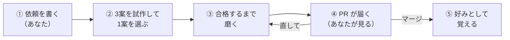
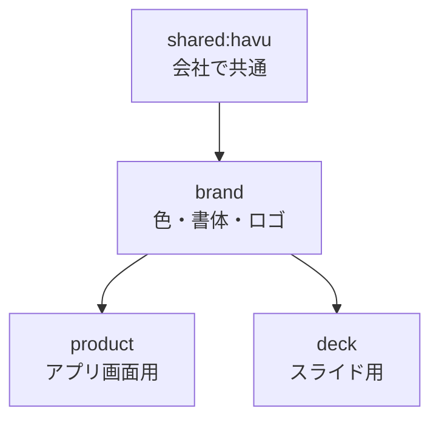
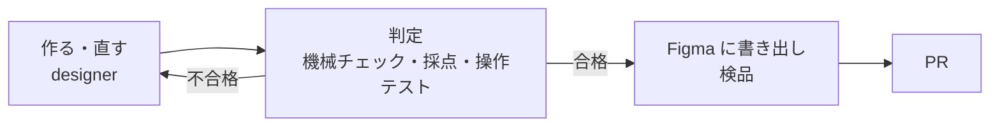

<div align="center">

# tanren

**デザインを依頼すると、案を出し、作り、採点して、PR で届けるスタジオ。**

Claude Code の plugin です。レビューするほど、あなたの審美眼を覚えていきます。

[はじめかた](#はじめかた) · [使い方](#使い方) · [コマンド一覧](#コマンド一覧) · [困ったとき](#困ったとき)

</div>

---

## tanren でできること

あなたがやるのは **依頼を書くこと** と **届いた PR を見ること** だけです。あいだの工程は、9人の AI スタッフが受け持ちます。



最初の5件は、②の1案をあなたが選びます。6件目からは AI の審査員が選びます。

### 作れるもの

| 種類 | 例 |
|---|---|
| アプリ・Web の画面（`ui`） | アプリ画面、管理画面、Web アプリ |
| プロトタイプ（`prototype`） | 画面遷移して触れる HTML モック |
| Web サイト（`web`） | LP、コーポレートサイト、記事ページ |
| リニューアル（`renewal`） | 既存サイトの作り直し。URL を渡すと全ページを棚卸しする |
| バナー（`banner`） | ディスプレイ広告のサイズ一式 |
| SNS（`social`） | 投稿、ストーリーズ、OGP、サムネイル |
| 印刷物（`print`） | ポスター、チラシ、名刺（PDF のカンプ） |
| スライド（`slide`） | 提案書、登壇資料 |
| メール（`email`） | HTML メール |
| 図解（`infographic`） | 図解、フロー図 |
| モーション（`motion`） | 動くバナー、UI アニメーション |
| ロゴ・アイコン（`identity`） | ロゴ案、アイコンセット |

---

## はじめかた

> [!IMPORTANT]
> **必要なもの**
> - Claude Code（ターミナル、またはデスクトップアプリの Code タブ）
> - Node.js（撮影と採点に使う Playwright のため）

### 1. plugin を入れる（Mac ごとに1回）

Claude Code の中で、次の2つを順に実行します。

```text
/plugin marketplace add monkeikawashima/tanren
```

```text
/plugin install tanren@tanren
```

インストール先を聞かれたら **project** を選びます。tanren を使うリポジトリでだけ動くようになります。

> [!TIP]
> **user**（全リポジトリ）で入れた場合は、`~/.claude/settings.json` の `"tanren@tanren"` を `false` にしておくのがお勧めです。`/tanren:studio-init` を実行したリポジトリでだけ有効になり、関係ないリポジトリで「〇〇を作って」と書いても tanren が動かなくなります。

> [!TIP]
> デスクトップアプリなら、入力欄の横の **＋ → Add plugins** からも入れられます。

> [!NOTE]
> 次の「2. リポジトリを準備する」を済ませると、新しい版が自動で届くようになります。それより前に入れただけの状態では、自動では届きません（公式以外の配布元は、自動更新が既定で切れているため）。先にオンにしたいときは、`/plugin` → **Marketplaces** → **tanren** → **Enable auto-update** を選びます。

### 2. リポジトリを準備する（リポジトリごとに1回）

デザインを置きたいリポジトリで実行します。

```text
/tanren:studio-init
```

途中で2つのことを聞かれます。

- [ ] **デザインシステム**：クライアントの色・書体・部品の決まりを取り込むか（使わない、あとで、も選べます）
- [ ] **審美眼の種まき**：好きな事例・嫌いな事例と、2案から選ぶ質問が6〜8組（10〜15分）

終わると、リポジトリに `studio/`（好みと設定）と `jobs/`（案件）ができ、撮影に使う Playwright も入ります。

### 3. 依頼する

あとは普通に頼むだけです。

> 社内勉強会の告知バナー。300x250 と 728x90。タイトル「デザインと AI の現在地」、11月20日 19時、オンライン。

方向性の3案、磨き、採点を経て、PR が届きます。

---

## 使い方

### 依頼を書く

書いてあることしか使わない、が tanren の決まりです。**文言・数字・日付は、依頼文に書いたものだけ** が成果物に載ります。

| 書くとよいこと | 例 |
|---|---|
| 何を作るか | LP のファーストビュー、バナー3サイズ |
| 誰が見て、何をしてほしいか | 展示会の来場者に、資料請求してほしい |
| 使ってよい文言・数字 | キャッチ、CTA、価格、実績 |
| 近づけたい雰囲気・避けたいもの | 余白を広く、写真は使わない |
| 使うデザインシステム（任意） | 「スライドは deck で」 |

足りない文言は、本番と同じ見た目の **仮のコピー**（「仮」の札つき）で埋まります。数字や社名のように仮でも書けない所は、**要コピー** の差し込み口になります。画像が足りない所は、用途と比率を書いた **仮素材** が入ります。どれも PR に一覧で載るので、あとから差し替えてください。

### 方向性を選ぶ（最初の5件だけ）

最初の5件は、3案の試作が届いた時点で一度止まり、どれで進めるかを聞かれます。

> d2 で。余白の取り方がいい

選んだ案と選ばなかった案は、あなたの好みとして記録されます。6件目からは AI の審査員が選びます（件数は設定で変えられます）。

### レビューする

PR には次のものが載ります。

| PR に載るもの | 中身 |
|---|---|
| スコア表 | 採点の結果と、何回目で合格したか |
| スクショ | 合格した成果物 |
| プレビュー | 触れるモックの URL（Claude Artifact、非公開） |
| Figma | 書き出したファイルと、最初に見る「00 Review」 |
| 確かめてほしいこと | 仮のコピー・仮の画像・要コピーの一覧、未確定事項、質問 |

直してほしいときは、チャットで伝えるか、PR にコメントします。

> ボタンの色がブランドと違う。全体的にもう少し軽く

指摘は「今回だけ直すこと」と「次からも守る好み」に分けて記録され、次の案件から効きます。良ければ、そのままマージしてください。

### デザインシステムを使う

クライアントの色・書体・部品の決まり（デザインシステム）を取り込むと、その範囲で作ります。取り込み元は5種類から選べて、組み合わせもできます。

| 取り込み元 | 例 |
|---|---|
| Claude の Design System | claude.ai で作ったデザインシステム |
| Figma | ライブラリのファイル |
| コード | トークンのファイル、CSS 変数、Tailwind の設定 |
| ブランドガイド | PDF、Notion、Google ドキュメント |
| 既存の Web サイト | URL から、実際に使われている色と書体を数える |

種類ごとに別のデザインシステムを使い分けたり、共通の土台に重ねたりもできます。



設定の確認と変更は、言葉で頼めば動きます。

| こう頼むと | こうなる |
|---|---|
| どのデザインシステムを使ってる？ | 既定と、種類ごとの割り当てを一覧にする |
| スライドは deck にして | スライドの案件で deck を使う |
| ロゴは縛らないで | ロゴの案件ではデザインシステムを使わない |
| Figma のライブラリを product として取り込んで | 新しいデザインシステムを足す |
| brand を取り直して | 取り込み元の最新を取り込み直す |
| このデザインシステムを共通にして | ほかのリポジトリでも候補に出るようにする |

> [!NOTE]
> 設定を変えても、進行中の案件の見た目は変わりません。案件は始めたときの写しを最後まで使います。

### 好みを育てる

tanren は使うほどあなたの好みに近づきます。

| あなたがすること | tanren が覚えること |
|---|---|
| 最初の5件で方向性を選ぶ | どちらの案が好みか |
| PR にコメントする | 次からも守る基準、良い例・悪い例 |
| 手直しせずにマージする | 採点が正しかったか |
| 作り直しをお願いする | 採点が甘かったところ（次から辛くする） |

好みは `studio/taste/` に、リポジトリごとに貯まります。

### 成績を見る

> 精度はどうなってる？

と聞くと、次の4つの推移を返します。毎晩の振り返り（任意）を設定すると、繰り返す失敗から作り方と機械チェックも自動で直していきます。

- 一発目の平均点
- 合格までの回数
- 手直しなしで通った割合
- 採点が甘かった件数

---

## コマンド一覧

どれも、言葉で頼めば自動で選ばれます。コマンドで呼ぶと確実です。

| コマンド | 使うとき |
|---|---|
| `/tanren:studio-init` | リポジトリで使い始めるとき（1回） |
| `/tanren:design-job` | デザインを依頼するとき |
| `/tanren:design-feedback` | 成果物を直してほしいとき、レビューを記録したいとき |
| `/tanren:design-system` | デザインシステムを見る・決める・変えるとき |
| `/tanren:design-system-import` | デザインシステムを取り込むとき |
| `/tanren:studio-coach` | 成績を見る、スタジオを振り返るとき |

---

## 品質を守るしくみ

合格するまで、何度でも差し戻します。AI が自分で「できました」と止まることはありません。



| 段階 | 何を見るか |
|---|---|
| 機械チェック | はみ出し、文字切れ、コントラスト、小さすぎる文字、リンク切れ、書体の置き換わり、文字組み（行間・1行の字数・見出しの改行・文字サイズの段数）、デザインシステムにない色 |
| critic | あなたの「良い例」と並べて見劣りしないか、デザイン品質・独自性・クラフト・機能性の4項目 |
| user-tester | 画面やプロトタイプで、想定した人が目的を果たせるか（画面系の案件だけ） |
| Figma の検品 | 合格した見た目との一致、レイヤー名、オートレイアウト、変数、部品化 |

---

## 困ったとき

<details>
<summary><b>tanren のコマンドが出てこない</b></summary>

1. `/reload-plugins` を実行します。
2. `claude plugin list` で `tanren@tanren` が `enabled` か確かめます。`disabled` なら、そのリポジトリの `.claude/settings.json` で `false` になっていないかを見てください。
3. 入れていないリポジトリなら、そのリポジトリで `/tanren:studio-init` を実行します。

</details>

<details>
<summary><b>新しい版が届かない</b></summary>

- 自動更新がオンか確かめます。`/tanren:studio-init` を実行したリポジトリでは自動でオンになります。それ以外では、`/plugin` → **Marketplaces** → **tanren** → **Enable auto-update** でオンにします。
- `DISABLE_AUTOUPDATER=1` や `DISABLE_UPDATES=1` を設定していると、plugin の更新も止まります。plugin だけ更新したいときは `FORCE_AUTOUPDATE_PLUGINS=1` を足します。
- すぐ最新にしたいときは、次の2つを実行します。

```text
/plugin marketplace update tanren
```

```text
/plugin update tanren@tanren
```

自動更新がオンなら、対話のセッションで最初のメッセージを送ってから最大10分のうちに新しい版を取ってきて、次の起動（または `/reload-plugins`）から効きます。`claude -p` だけで動かす環境では、自動では取ってきません。

</details>

<details>
<summary><b>「playwright がこのリポジトリに入っていません」と出る</b></summary>

撮影と採点に使う Playwright が、そのリポジトリにありません。`/tanren:studio-init` を実行するか、`pnpm run setup` を実行してください（npm のリポジトリなら `npm run setup`）。

</details>

<details>
<summary><b>「書体の置き換わり」で不合格になる</b></summary>

指定した書体が読み込めず、別の書体で表示されています。Google Fonts はネットワークがないと読めません。ネットワークのない環境では、書体のファイルを案件の `assets/` に置いて読み込みます。

</details>

<details>
<summary><b>「デザインシステムが未設定」と出る</b></summary>

studio-init で「あとで」を選んだままです。`/tanren:design-system` で決めてください。使わないなら「このリポジトリではデザインシステムを使わない」と伝えます。

</details>

<details>
<summary><b>Figma の工程が飛ばされる</b></summary>

Claude Code に Figma のコネクタがつながっていないと、Figma の工程は自動で飛ばされ、PR に「Figma 未接続」と書かれます。

</details>

---

## もっと詳しく

<details>
<summary><b>リポジトリにできるもの</b></summary>

```text
あなたのリポジトリ/
├─ studio/
│  ├─ config.json        設定
│  ├─ taste/             あなたの好み（基準・良い例・悪い例・二択の記録）
│  ├─ design-system/     取り込んだデザインシステム（名前ごと）
│  ├─ benchmark/         採点が正しいかを確かめる検証セット
│  └─ metrics/           採点の記録とダッシュボード
├─ jobs/
│  └─ 20261120-banner/   1件の依頼 = 1フォルダ = 1ブランチ = 1 PR
└─ .claude/settings.json tanren を有効にする設定と、許可の設定
```

</details>

<details>
<summary><b>設定（studio/config.json）</b></summary>

| 項目 | 既定 | 意味 |
|---|---|---|
| `defaults.pass_score` | 8 | 合格点（10点満点） |
| `defaults.directions` | 3 | 最初に出す方向性の数 |
| `defaults.build_max` | 10 | 磨きの回数の上限。超えたら未合格のまま PR にする |
| `defaults.usertest_max` | 3 | 操作テストの回数の上限 |
| `defaults.figma_max` | 5 | Figma の検品の回数の上限 |
| `defaults.human_pick_first` | 5 | 方向性をあなたが選ぶ件数 |
| `design_systems` | 未設定 | デザインシステムの既定と、種類ごとの割り当て。`/tanren:design-system` で変える |
| `figma.*` | 空 | 書き出し先のチーム、プロジェクト、ライブラリ |
| `notify.slack_channel` | 空 | 納品を知らせる Slack のチャンネル |
| `budget.critic_usd_per_run` | 3 | 採点1回あたりの費用の上限（ドル） |

</details>

<details>
<summary><b>クラウド（claude.ai の Project）と GitHub Actions で使う</b></summary>

**Project**：リポジトリの `.claude/settings.json` は読み込まれないので、Project の設定の **Plugins** で、配布元 `monkeikawashima/tanren` と `tanren` を追加します。PR のラベルやマージをきっかけに動く設定、毎晩の振り返りなど、手順の全体は [docs/setup.md](docs/setup.md) にあります。

**GitHub Actions**：`anthropics/claude-code-action` の入力に次の2つを渡します。

```yaml
plugin_marketplaces: https://github.com/monkeikawashima/tanren.git
plugins: tanren@tanren
```

</details>

<details>
<summary><b>Claude 公式の機能との関係</b></summary>

| 公式の機能 | tanren での使い方 |
|---|---|
| `/goal`（Stop hook） | 使いません。会話ログだけでなく画像を見て判定する、自前の関門 hook を使います |
| Dynamic workflows | 方向性の3案を並列に作る工程。スキルが指示するので、キーワードは要りません |
| サブエージェント | 9人のスタッフ（director・designer・judge・critic・user-tester・figma-builder・figma-critic・librarian・coach） |
| Artifacts | モックのプレビュー。修正しても同じ URL を更新します |
| Projects・スケジュールタスク | 依頼の窓口、PR をきっかけにした学習、毎晩の振り返り |

</details>

<details>
<summary><b>動作確認の範囲</b></summary>

| 確認済み | 方法 |
|---|---|
| 関門の全工程と、上限に達したときに納品へ進む経路 | 採点役を差し替えたテスト |
| 機械チェック（はみ出し・コントラスト・文字サイズ・リンク切れ・書体・文字組み・デザインシステムにない色） | 問題を仕込んだ HTML |
| 本物の critic による採点 | 告知バナーのサンプル。数値つきの修正リストが返った |
| plugin の構造 | `claude plugin validate` |
| GitHub から入れた plugin で、9人のスタッフが読み込まれること | 新しいセッションで確認 |
| デザインシステムの選び方と重ね合わせ | 使い捨てのリポジトリでテスト |

| まだ確かめていないこと | 補足 |
|---|---|
| 実際の案件を通しで回したときの動き | 方向性の選択、仮の画像の生成、デザインシステムの取り込みを含む |
| plugin にしたあとの本物の critic による採点 | 起動のしかたは確認済み |
| Project のスレッドで plugin が動くか | private の配布元をクラウドから読めるかを含む |
| Figma への書き出しと検品 | Figma のコネクタが要る |

**既知の弱点**：グラデーションや画像の上にある文字のコントラストは、機械チェックでは測れません。critic が目で見て指摘します。

</details>

---

<div align="center">

[更新履歴](CHANGELOG.md) · [ライセンス](LICENSE) · 作者 [@washimaka](https://x.com/washimaka)

Copyright © 2026 HAVU LLC. 誰でも使えます。改変・再配布・販売はできません。

</div>
